<div align="center">
  
</div>

# proto-pollute

> A bounded, heuristic prototype-pollution assessment tool for authorized testing.

```bash
python proto_pollute.py --help
```

The tool sends four JSON POST probes to the supplied HTTP(S) endpoint and, with
`--qs`, three query-string probes. It accepts URLs up to 2,048 characters,
timeouts from 0.1 to 60 seconds, and reads at most 8 KiB from each response.
Only use it with systems you own or are explicitly authorized to assess; these
are real HTTP requests and are not a passive or static source-code analysis.

A reflected marker is reported as a `heuristic_candidate`, not as a confirmed
prototype-pollution vulnerability. Reflection can be ordinary input echoing and
does not establish that a prototype was modified or that the behavior is
exploitable. Network and output-file errors are reported explicitly and cause a
non-zero exit status.

Optional request headers and JSON output:

```bash
python proto_pollute.py https://authorized.example/api --qs \
  --header "Authorization: Bearer TOKEN" --out results.json
```

Run the offline regression suite without contacting a target:

```bash
python -m unittest discover -s tests -v
```

**Omar Khalid** — [omareldemery.com](https://omareldemery.com)
